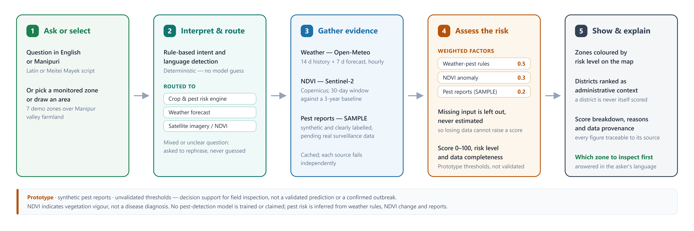

# LouNgak AI

**Crop and pest risk monitoring for Manipur farmland, with plain-language questions in English or Manipuri and
satellite imagery analysis behind every answer.**

LouNgak AI combines hourly weather, Sentinel-2 vegetation change (NDVI) and pest reports into an explainable risk
score for monitored farmland zones, shows the zones on a map with the reasons for each score, and answers
questions such as *Which areas are high risk?*, *Why is Bishnupur flagged?* or *Which should we inspect first?*,
typed in English or in Manipuri (Latin script or Meitei Mayek). It can also answer questions about satellite
imagery of any drawn area: water, crop health, change over time, and the weather forecast.

It is a working **prototype**. The pest reports are synthetic and the agronomic thresholds are unverified
placeholders; both are labelled as such everywhere they appear (see [Limitations](#limitations)).



## Who it is for

Agricultural officers and extension staff who need to decide which farmland to inspect first. LouNgak AI is
decision support for field inspection: it points at where the evidence suggests a closer look, and it never claims
that a pest is present.

## Features

- **Crop & pest risk dashboard.** Seven demonstration zones over Manipur valley farmland (Kakching, Bishnupur,
  Imphal West, Imphal East, Thoubal, Jiribam and Churachandpur; the Jiribam zone is `demo-jiribam-sonapur`,
  farmland near Sonapur), coloured by risk level, with a priority list, a district drill-down, and a "Why is this
  area at risk?" panel with the score breakdown, reasons and data provenance.
- **Explainable risk engine.** Weather-based pest rules (Open-Meteo), an NDVI anomaly against earlier years
  (Copernicus Sentinel-2) and pest-report pressure, combined with stated weights. An input that cannot be fetched
  is left out of the score and lowers the stated data completeness; it is never estimated.
- **Questions in English or Manipuri.** A deterministic, rule-based router reads the question's language and
  intent and sends it to the risk engine, the weather forecast or satellite analysis. Meitei Mayek is
  transliterated to Latin script first. Risk answers to Manipuri questions are given in Latin Manipuri from reviewed
  templates. Unclear or mixed questions are asked to be rephrased, not guessed. Irrigation questions ("Is it safe to
  irrigate?") are kept away from the risk engine and handled as imagery questions.
- **Satellite imagery analysis.** Draw an area or upload a GeoTIFF, then ask: crop health (NDVI on cloud-free land
  pixels), water (NDWI, with Sentinel-1 radar when the area is too cloudy), change between two dates, combined
  optical and radar analysis, and scene description or grounding by a remote-sensing vision-language model
  (Falcon, 0.7B, with a LoRA adapter fine-tuned for this project).
- **Weather.** Short-range forecasts (today to 16 days) for a point inside the selected area.
- **Auditable results.** Every answer shows its method, confidence and data sources; imagery answers include the
  full execution trace and downloadable HTML/JSON reports.

## Architecture

| Layer | Technologies |
|---|---|
| Web client (`web/`) | React 18, TypeScript, Vite, Tailwind CSS, MapLibre GL, Terra Draw, Zustand |
| Backend (`satquery/`) | Python, FastAPI, Uvicorn, Pydantic, httpx; serves the API and the built web client on one port |
| Risk engine (`satquery/agri/`) | Rule-based scoring; weights, rules and zones are data files in `satquery/agri/assets/` |
| Language (`satquery/agent/`) | Rule-based intent routing, Latin Manipuri lexicon, Meitei Mayek transliteration |
| Imagery (`satquery/agent/`, `satquery/specialists/`, `satquery/providers/`) | Rasterio, NumPy, SciPy; PyTorch, Transformers and PEFT for the optional vision-language model |

The Python package is named `satquery` after the satellite-query engine at its core, and its settings use the
`SATQUERY_` prefix. See [docs/architecture.md](docs/architecture.md) for where each stage lives in the code and
for the risk-engine parameters.

## Prerequisites

- **Python 3.12** (3.10 to 3.12 are supported; 3.13 and newer are not), ideally with [uv](https://docs.astral.sh/uv/).
- **Node.js 20 or newer** with npm.
- **Internet access** for weather, satellite imagery, place search and basemaps (see
  [External services](#external-services)).
- Optional, for satellite imagery: a free **Copernicus Data Space Ecosystem** account.
- Optional, for the vision-language model: about 3.5 GB of disk for the model download, plus 1–3 GB for PyTorch.
  An NVIDIA GPU makes a model call take under a second (about 2 GB of VRAM); on CPU it takes roughly 15–20 seconds.

## Installation

The commands are for Windows PowerShell. On Linux or macOS, use `.venv/bin/python` instead of
`.venv\Scripts\python` and `cp` instead of `Copy-Item`.

On Windows, clone into a short path such as `D:\LouNgak-AI`: the evaluation test split has file paths up to 100
characters long, which exceeds Windows' 260-character limit inside a deep folder. Alternatively, run
`git config --global core.longpaths true` before cloning.

```powershell
git clone https://github.com/brajalairen/LouNgak-AI.git
cd LouNgak-AI

# 1. Python environment
uv venv --python 3.12 .venv
uv pip install --python .venv -e ".[server,copernicus,dev]"

# 2. Web client
cd web
npm ci
npm run build
cd ..

# 3. Configuration
Copy-Item .env.example .env
```

This installs everything except the vision-language model. To add it (needed only for open-ended image questions
such as scene description), install the model extras as well:

```powershell
# Optional, NVIDIA GPU only: install the CUDA build of PyTorch first
uv pip install --python .venv torch==2.8.0 --index-url https://download.pytorch.org/whl/cu128
uv pip install --python .venv -e ".[server,copernicus,dev,models,adaptation]"
```

The `adaptation` extra pins PEFT 0.17.1 and Accelerate 1.10.1 next to Transformers 4.49.0 (the Falcon model's
code does not work with Transformers 4.50 or newer). Install them through this extra; a separate `pip install peft`
can upgrade Transformers and break the model.

Without uv: create the environment with Python 3.12 (`py -3.12 -m venv .venv`), then run
`.venv\Scripts\python -m pip install -e ".[server,copernicus,dev]"` (add `,models,adaptation` for the model).

## Configuration

Settings are read from environment variables, or from a `.env` file in the repository root. `.env` is gitignored;
never commit real credentials. Start from `.env.example`, which lists every setting with its default.

| Variable | Default | Purpose |
|---|---|---|
| `SATQUERY_VLM_BACKEND` | `fake` | `falcon` runs the vision-language model (needs the model extras); `fake` gives placeholder text for open-ended image questions. `.env.example` sets `falcon`: change it to `fake` if you did not install the model. |
| `COPERNICUS_CLIENT_ID`, `COPERNICUS_CLIENT_SECRET` | empty | Copernicus Data Space OAuth client, for live Sentinel-1/2 imagery and the NDVI risk factor |
| `SATQUERY_DEVICE` | `auto` | `auto`, `cuda` or `cpu` for the model |
| `SATQUERY_FALCON_ADAPTER` | `adapters/falcon-bigearthnet-vqa-lora` | The included LoRA adapter; set it empty to run the base model |
| `SATQUERY_AGRI_DISTRICTS` | empty | Path to a district-boundary GeoJSON, drawn as map context only (none is included; see [docs/geo/](docs/geo/district-boundaries-sources.md)) |
| `SATQUERY_AGRI_PEST_RULES`, `SATQUERY_AGRI_RISK_MODEL` | the files in `satquery/agri/assets/` | Reviewed replacements for the placeholder pest rules and risk weights |
| `SATQUERY_AGRI_MODE` | `live` | `live` (falls back to a saved snapshot when live data is incomplete) or `snapshot` |
| `SATQUERY_AGRI_OFFLINE` | off | `1` serves cached agricultural data only, with no network calls |
| `SATQUERY_WEATHER` | `open-meteo` | `off` disables weather questions |

**Copernicus credentials:** create a free account at [dataspace.copernicus.eu](https://dataspace.copernicus.eu),
open the Sentinel Hub dashboard, go to **User settings → OAuth clients**, create a client, and copy its ID and
secret into your `.env` (the secret is shown only once). If you have no account, leave both values empty: the
placeholder values from `.env.example` are sent as credentials, rejected, and reported as such in every NDVI
result. Without credentials the app still runs: the risk engine scores
zones from weather and pest reports with lower data completeness, and imagery questions about a drawn area explain
that retrieval is not configured. Uploaded GeoTIFFs and the built-in imagery examples keep working.

## Running

```powershell
.venv\Scripts\python -m uvicorn satquery.server:app --port 8000
```

Open **http://127.0.0.1:8000**. FastAPI serves the API and the built web client on this one port. The first risk
assessment is computed in the background at start-up, so the dashboard fills in after a few seconds.

**Frontend development:** run the backend as above, then `npm run dev` in `web/` and open
**http://localhost:5173**. Vite reloads on changes and forwards `/api` to port 8000.

**Risk engine from the command line:**

```powershell
.venv\Scripts\python -m satquery.agri assess        # rank the demo zones with live data
.venv\Scripts\python -m satquery.agri thresholds    # show whether thresholds are PLACEHOLDER or VERIFIED
.venv\Scripts\python -m satquery.agri warm --save-snapshot --crop-health
```

`warm` fetches today's data, saves it as the fallback snapshot (`runs/agri/snapshot.json`) used when live data is
incomplete, and warms the crop-health imagery cache. Run it before a presentation so the dashboard never waits on
a slow provider.

### Things to try

1. The dashboard opens on Manipur with the priority list. Click a zone for **Why is this area at risk?**
2. Ask *Which areas are high risk?*, *Why is Jiribam flagged?* or *Which should we inspect first?*
3. Ask in Latin Manipuri, for example *Karmba mafam high risk ta lei?* (Which areas are at high risk?) or
   *Bishnupurbu karigi priority pikhibano?* (Why was Bishnupur prioritized?)
4. Draw a rectangle over farmland (for example Thoubal–Kakching, W 93.95, S 24.45, E 94.03, N 24.52) and ask
   *How healthy is the crop here?* or *Will it rain here tomorrow?*
5. Upload `demo/examples/bigearthnet_river_austria/s2_bgrn.tif` with **Add data** (**+**) and ask *Highlight the
   water body in this image.*

## Tests and production build

The tests use synthetic data: no GPU, network or credentials.

```powershell
.venv\Scripts\python -m pytest     # backend
cd web
npm test                           # frontend unit tests (Vitest)
npm run typecheck                  # TypeScript
npm run build                      # production build into web/dist
cd ..
```

In a fresh clone, `uv sync --dev` followed by `uv run pytest` also works, with versions pinned by `uv.lock`. Do not
run `uv sync` in an environment that has the model extras: it removes packages outside the test set, such as
PyTorch.

Tests that call real services are deselected by default: `pytest -m live` runs them (Copernicus and Open-Meteo,
which use quota), and `pytest -m gpu` the model tests.

## External services

LouNgak AI is not an offline application. It calls:

| Service | Used for | Account |
|---|---|---|
| [Open-Meteo](https://open-meteo.com) | Hourly weather for the risk engine; forecasts | None (free API) |
| [Copernicus Data Space Ecosystem](https://dataspace.copernicus.eu) | Sentinel-2 NDVI for the risk engine; Sentinel-1/2 imagery for drawn areas | Free account (OAuth client) |
| OpenStreetMap Nominatim | Place search; district context for zones | None |
| OpenFreeMap / OpenStreetMap and Esri World Imagery | Basemaps in the browser | None |
| Hugging Face | One-time download of the vision-language model (optional) | None |

Each source fails independently: an unreachable source makes its part of an answer unavailable, and says so,
without stopping the rest. `SATQUERY_AGRI_OFFLINE=1` or `SATQUERY_AGRI_MODE=snapshot` serves the risk dashboard
from cached or saved data.

## Limitations

- **Prototype, not a validated prediction.** The score indicates where the evidence suggests an inspection; it is
  not a probability of infestation and has not been calibrated against field outcomes.
- **Synthetic pest reports.** No public, machine-readable pest or disease observation dataset for Manipur was found
  ([docs/pest-data-sources.md](docs/pest-data-sources.md)), so the pest reports are generated, labelled
  "SAMPLE DATA — Prototype Simulation" wherever they appear, and cap the confidence at medium.
- **Placeholder thresholds.** The pest rules and risk weights in `satquery/agri/assets/` are marked PLACEHOLDER
  until an agronomist verifies them; confidence is low while they are.
- **Demonstration zones.** The seven monitored zones are hand-drawn rectangles, not administrative boundaries.
  District outlines are optional and not included, because the Survey of India data cannot be redistributed.
- **NDVI measures vegetation vigour**, not disease. Weather data is model data for one point per zone, not station
  observations. Cloud often hides the valley in the monsoon, and then the NDVI factor is unavailable.
- **Manipuri.** The answer templates were reviewed by a fluent speaker; the routing lexicon is still a draft.
  Weather answers are given in English only.
- **Imagery.** Heuristic components (spectral and radar thresholds, change maps, optical/radar agreement) are
  labelled as heuristics, and confidence values state their method but are not calibrated. Live retrieval is limited
  to drawn areas up to 400 km², and radar change over time is not supported.
- **Vision-language model.** The LoRA adapter improves yes/no questions about Sentinel-2 patches only; see
  [experiments/adaptation/README.md](experiments/adaptation/README.md) for its evaluation.
- **No conversation or voice mode.** Each question is answered on its own. A design note for adding conversation
  later is kept on the `future/conversation-voice-stub` branch.

## Data and licences

- Code: Apache License 2.0 ([LICENSE](LICENSE)).
- Weather: Open-Meteo.com, CC BY 4.0 (attributed in every weather answer).
- Satellite imagery: Copernicus Sentinel data via the Copernicus Data Space Ecosystem. LouNgak AI is not affiliated
  with or endorsed by Copernicus or the European Commission.
- Place and district names: OpenStreetMap contributors (ODbL); district names follow India's Local Government
  Directory.
- District boundaries (optional, not included): Survey of India. See
  [docs/geo/district-boundaries-sources.md](docs/geo/district-boundaries-sources.md).
- Demo imagery in `demo/examples/` and the test split in `experiments/adaptation/test_split/`: BigEarthNet v2.0 /
  BigEarthNet.txt (CDLA-Permissive-1.0) and modified Copernicus Sentinel data; see the READMEs there.
- Model: `mehmetbayik/Falcon-Single-Instruction-Large` on Hugging Face, downloaded at run time under its own
  licence. The LoRA adapter in `adapters/` was trained for this project
  ([experiments/adaptation/](experiments/adaptation/README.md)).
- Basemaps: OpenFreeMap / OpenStreetMap contributors, and Esri World Imagery.
