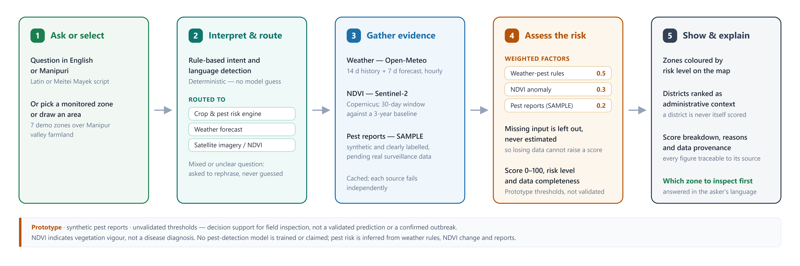

# Architecture

LouNgak AI is one FastAPI backend (Python package `satquery`) that also serves the built React web client
(`web/`). Everything is rule-based and auditable except the optional vision-language model, which answers
open-ended questions about images.

The detailed, branch-by-branch flow (routing rules, area resolution, each evidence source's failure modes, and
the exact level and confidence rules) is in [diagrams/technical-flow.png](diagrams/technical-flow.png). Both
diagrams have editable Mermaid sources next to them.

## Where each stage lives

| Stage | Code |
|---|---|
| 1 Ask or select | `web/src/command/AICommandBar.tsx`; `satquery/agent/language.py`, `satquery/agent/meitei_mayek.py`; monitored zones in `satquery/agri/assets/demo_areas.geojson` (7) |
| 2 Interpret and route | `POST /api/route` in `satquery/server.py`; `satquery/agri/query.py` (`decide`); routes `agri` / `weather` / `imagery` / `mixed` |
| 3 Gather evidence | `satquery/agri/pipeline.py` (`default_sources`, `assess_area`); `satquery/agri/weather.py` (Open-Meteo), `satquery/agri/ndvi.py` (Copernicus Sentinel-2), `satquery/agri/reports.py` (SAMPLE) |
| 4 Assess the risk | `satquery/agri/risk.py` (`weather_factor`, `ndvi_factor`, `report_factor`, `combine`); weights in `satquery/agri/assets/risk_model.json`, pest rules in `satquery/agri/assets/pest_rules.json` |
| 5 Show and explain | `satquery/agri/routes.py` (`/api/agri/*`); `web/src/agri/` (`RiskLayer` zone outlines and ranks, `PriorityPanel`, `AreaRiskDrawer`) |
| Imagery questions | `satquery/agent/` (intent, plan, execution, aggregation), `satquery/specialists/` (VLM, analysis tools, weather), `satquery/providers/copernicus.py` (Sentinel-1/2 retrieval), `satquery/raster_analysis.py` |
| Manipuri answers | `satquery/agri/answer_language.py` with templates in `satquery/agri/assets/manipuri_responses.json` |
| Alerts (LouNgak Watch) | `satquery/watch/alerts.py` (`derive`: heavy rain, crop health, pest/disease watch) from the assessment; rules in `satquery/watch/assets/alert_rules.json`; `web/src/pages/WatchPage.tsx` |
| Field operations | `satquery/ops/` (`service.py` workflow and permissions, `users.py` demo accounts, `routes.py` `/api/ops/*`, `seed.py`); `satquery/store.py` (SQLite); `web/src/pages/` (`FieldOpsPage`, `MyTasksPage`, `ReportPage`, `MyReportsPage`) |
| Agricultural map | `satquery/agmap/` (`/api/map/layers`, `/api/map/cells/{cell}`: H3 resolution-7 display cells with WorldCover land cover, the SAMPLE crop mix, zone ids and district outlines; one cell's records filtered by account); assets built by `scripts/build_map_assets.py`; `web/src/agmap/` (`AgLayers`, `PinsLayer`, `LayerPanel`, `MapToolbar`, `CellSummary`, `CellPanel`, `useMapStore`) |
| Grid and Crop Atlas | `satquery/grid.py` (H3 resolution 8 locates reports and tasks); `satquery/atlas/` (`/api/atlas/crops`), `web/src/pages/AtlasPage.tsx` |
| App shell and roles | `web/src/shell/` (`useSession` demo account and page, `AppShell` top bar); `web/src/App.tsx` |

## Risk engine parameters (placeholders)

All of these are data in `satquery/agri/assets/risk_model.json` and `pest_rules.json`, marked PLACEHOLDER, and can
be replaced by reviewed copies (`SATQUERY_AGRI_RISK_MODEL`, `SATQUERY_AGRI_PEST_RULES`) without code changes.

- Weights: weather-pest rules 0.5, NDVI anomaly 0.3, pest-report pressure 0.2.
- Weather: 14 days of hourly history plus a 7-day forecast (including today) for one point per zone.
- NDVI: a 30-day window compared with the same window in up to 3 earlier years.
- Pest reports: a 14-day look-back.
- Levels: CRITICAL at a score of 0.80 or more when at least 2 factors score 0.60 or more and data completeness
  is at least 90% (otherwise such a score is HIGH); HIGH at 0.60; MODERATE at 0.35; LOW below. Below 50%
  completeness the level is INSUFFICIENT_DATA.
- Missing inputs are left out of the score, never estimated, so missing data cannot make an area look safer or
  more urgent than the evidence supports.
- Confidence comes from data completeness, is capped at medium when SAMPLE data is used, and is low while any
  threshold is a PLACEHOLDER.

## Not implemented

- **A trained pest or disease detection model.** Pest risk is inferred from weather rules, NDVI change and
  reports.
- **Real pest/disease surveillance data.** No public machine-readable observation dataset for Manipur was found
  (see [pest-data-sources.md](pest-data-sources.md)), so pest reports are SAMPLE: synthetic and labelled.
- **Verified agronomic thresholds.** The pest rules and risk weights are PLACEHOLDER until an agronomist reviews
  them.
- **Verified district boundaries.** The map ships OpenStreetMap reference outlines; Survey of India outlines load
  from a local file only, as their licensing does not allow redistribution (see
  [geo/district-boundaries-sources.md](geo/district-boundaries-sources.md)). Reports are not yet routed to a
  district automatically from these outlines.
- **Crop-type data.** The map's crop colours are a SAMPLE pattern; where farmland is comes from ESA WorldCover
  (see [geo/map-data-sources.md](geo/map-data-sources.md)).
- **Weather answers in Manipuri.** Manipuri risk answers are translated from reviewed templates; weather answers
  stay in English.
- **Conversation and voice mode.** Not part of the application; a design note for adding it later is kept on the
  `future/conversation-voice-stub` branch.
- **Real authentication.** Demo accounts are switched freely; the server enforces their role and jurisdiction.
- **Official warning ingestion** (IMD, CWC, NDMA), per-cell risk analysis (cells show their zone's level), and
  farmer reports feeding the risk score. See [Context/refined_foundation.md](../Context/refined_foundation.md).
